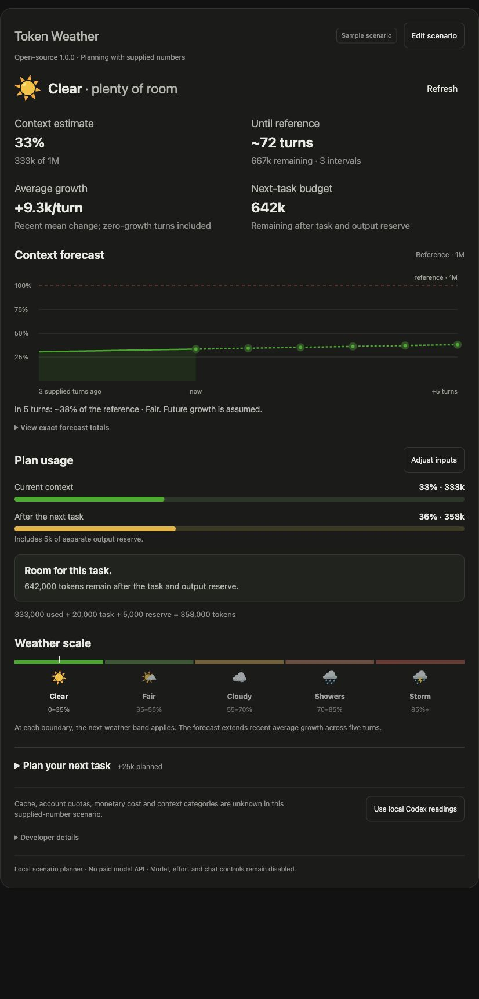

# Token Weather

Open-source version 1.0.0. Maintained by Feida Wang, trading as RSI AI. MIT License.

Plan room for the next task from numbers you provide. Run on your computer or deploy on a server you own. The publisher does not operate a shared budget service, require a new subscription or call a paid model API.

This is the MIT open-source edition, separate from the earlier skills-only 1.0.0 candidate. GitHub source distribution does not mean plugin-directory approval. A local command does not make a ready With MCP public upload.

## Try it locally

Use an existing Python 3.9+ runtime. From this directory:

```sh
python3 -B mcp/demo/server.py --port 0
```

Open the printed loopback URL. It makes real MCP calls with synthetic numbers. Ctrl+C stops it. No background service is installed and no dependency download is needed. To use a supported local MCP host, the root `mcp.json` declares the actual stdio command; registration is separate and is not performed by unpacking this archive.

## Latest scenario interface on main

The latest source keeps version 1.0.0 and adds a dark weather dashboard inspired by the project's existing visual language. The published v1.0.0 tag and release ZIP remain unchanged. To get this UI refinement, clone main or download [the latest source archive](https://github.com/FeidaWang/Token-Weather/archive/refs/heads/main.zip).



Use Edit scenario to open inputs; values such as 100,000, 100k and 1M are supported. The result shows current usage, recent growth, a five-turn reference forecast, the next-task budget and the complete arithmetic. A task exceeding the reference can be reduced to the available task size with one click. Unknown readings stay unknown, and the missing-input action focuses the required field. Optional live updates and Copy summary help you compare scenarios.

The screenshot shows a synthetic sample, not live Codex telemetry. Cache, account quotas, monetary cost and context composition are not fabricated. Developer traces are collapsed, and the local-reading guide explains the separate stdio tool.

## Plan your next task

When the tool is connected, say:

> My reference limit is 100000 tokens, usage is 65000, the next task adds 20000, and I want a separate output reserve of 5000. Will it fit?

You get current headroom 35000, planned usage 90000 and planned headroom 10000. The task increase excludes the separate reserve. Tag assumed estimates separately from supplied measurements; user-provided data is not independently verified.

A five-turn outlook needs three to six chronological turn-end totals. The last matches current usage. Decreases reset the growth sample. Missing data stays unknown. Forecasts extend recent mean change; they do not guarantee actual compaction timing, account allowance or monetary cost.

The MCP accepts numeric fields and fixed source enums only. Do not send messages, chat IDs, local paths, passwords, API keys or identity documents. It cannot inspect private ChatGPT context or account quota.

## Automatic local readings and adaptation

The local stdio MCP also exposes `inspect_local_context`. Give it the exact root thread ID from the current host and matching absolute workspace, or bind CODEX_THREAD_ID/TOKEN_WEATHER_WORKSPACE before launching it. Python 3.11+ is needed for this local adapter. It reads compatible numeric Codex events, not an arbitrary/latest chat, and returns usage estimates, model/effort, cache ratio, output average and account windows when present. It returns no message text, chat/turn IDs or paths.

For an automatic read-only refresh loop, from your current Codex project use the exact current root binding:

```sh
python3 scripts/local-observe.py --workspace . --watch --interval 5
```

Supply `--thread` when CODEX_THREAD_ID is unavailable. Ctrl+C stops the loop. Each read updates budget/task-size advice; missing or stale data cannot drive recommendations. A suggested output reserve is a labelled heuristic, not a model limit or spending guarantee. This adapter never appears in remote HTTP discovery or the self-hosted container.

Model changes, effort changes and automatic chat rotation are **disabled**. Those require a supported connection to the exact Desktop owner, complete task/policy checks and an explicit allowed model/cost policy. This release does not claim a new app-server can control an existing Desktop chat. See [Automation boundary](docs/AUTOMATION.md).

## Deploy on your own server

See [Self-hosting](docs/SELF-HOSTING.md). A Docker/Caddy example and a native Python option are included. Default operation stays on loopback; external binding requires your exact public HTTPS origin and your own TLS proxy. Your server, DNS, certificates, logs, retention and costs are your responsibility. No server resources are created by this archive. The native Python backend has passed an actual temporary loopback TLS-proxy test with certificate/hostname verification. Docker/Caddy, public DNS and live hosted deployment are not claimed as tested.

After deployment, use [the remote-config helper](docs/SELF-HOSTING.md) to write a separate configuration for your verified endpoint. The publisher does not receive request data from your deployment unless you choose to send it separately. This self-hosted source does not promise a universal directory installation or approval.

## Optional local Codex weather

Existing local readings, the original single-page display and checkpoints are retained. This optional mode needs compatible local Codex records and Python 3.11+.

> Show the local Codex weather for this chat.

> Open my Token Weather page.

The original page shows estimated usage, recent history and model/effort/account limits when available. Output tokens per second is a wall-clock turn average including waits, not generation speed. Closing that page does not stop its collection service; use the explicit stop command for the chat. The new budget demo does not replace it.

This source copy has no lifecycle hooks. The separate local package retains normal `/hooks` review; existing installed configuration and trust records are unchanged. Automatic chat moving stays off.

## Documentation and support

See [Start here](docs/START-HERE.md), [Local setup](docs/LOCAL-SETUP.md), [Self-hosting](docs/SELF-HOSTING.md), [Automation](docs/AUTOMATION.md), [Privacy](docs/PRIVACY.md), [Terms](docs/TERMS.md), [Support](docs/SUPPORT.md), [Contributing](CONTRIBUTING.md), [Release notes](docs/RELEASE-NOTES.md), [Review cases](docs/REVIEW-CASES.md), [Demo](docs/DEMO.md) and [Upload check](docs/UPLOAD-CHECK.md).

General support is public [GitHub Issues](https://github.com/FeidaWang/Token-Weather/issues). Do not post secrets or private records. Email support is not offered. Original software uses [MIT](LICENSE).

Source and downloads: https://github.com/FeidaWang/Token-Weather

Website and current privacy/usage guides: https://feidawang.github.io/Token-Weather/

Open-source distribution, user deployment and directory approval are separate states.

Weather image assets in the updated UI are unmodified Google Noto Emoji SVGs, under their upstream Apache 2.0 asset licence. Attribution and licence are bundled in mcp/demo/assets/. The project software remains MIT licensed.
