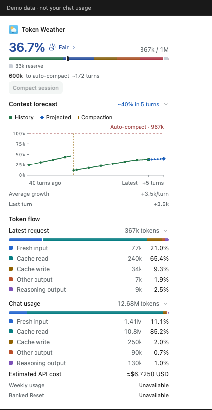

# Token Weather

[English](README.md)

Token Weather 帮你了解 Codex 聊天还可能有多少空间。你可以把它想成天气预报：它显示现在的情况，也粗略预测接下来可能发生什么。

**Token** 是一小段文字。聊天的**上下文**是模型一次能使用的信息。对话越来越长时，这个空间可能逐渐装满。Token Weather 帮你在开始下一项任务前留意剩余空间。

## 它能做什么？

- **查看聊天天气：** Rust 本地面板在数据足够时显示可用的上下文信息、近期变化和未来五轮的预测。
- **估算任务空间：** 在独立的预算计算器中输入自己的数字，看看下一项任务可能放不放得下。
- **自己掌控：** 在本机运行工具，或将数字预算计算器部署到自己的服务器。

读数和预测只是估算，不是保证。缺失或不受支持的数据会显示为未知。聊天上下文空间也不同于账户使用额度。Token Weather 不会自动迁移聊天或更换模型。

## 试用面板



*2.0.34 面板运行截图，使用示例数据。*

最新的 Rust 本地版本是 **2.0.34**，适用于 Apple 芯片的 macOS。[下载并查看发布说明](https://github.com/FeidaWang/Token-Weather/releases/tag/rust-v2.0.34)。下载后需要解压，并将其中的 `bin/token-weather-core` 注册到兼容的本地 MCP 宿主；仅下载不会自动安装或连接。详细步骤和校验值见[版本记录](docs/RUST-LOCAL-2.0.34.md)。

想先预览，又不连接自己的聊天？在干净的仓库副本中使用发布版本源码：

```sh
git switch --detach rust-v2.0.34
cargo build --release --locked --manifest-path rust/token-weather-core/Cargo.toml
rust/token-weather-core/target/release/token-weather-core serve --demo
```

打开终端打印出的本地地址。预览使用**模拟数据**，不是你的聊天数据。按 Ctrl+C 停止。构建需要 Rust 和 Cargo。实际的 MCP 运行程序读取宿主选中的聊天；能否读取取决于本地 Codex 版本和可用记录。手动压缩需要另行验证并登记的隔离 Codex 配置。

## 试用预算计算器

预算计算器是独立的 **1.0.0** 工具，使用你输入的数字，不会自动读取聊天。在仓库目录中，用 Python 3.9 或更高版本运行：

```sh
python3 -B mcp/demo/server.py --port 0
```

打开终端打印出的本地地址。演示页面默认使用示例数字。按 Ctrl+C 停止，无需安装额外的 Python 包。

例如，假设参考上限是 100,000 tokens，已用 65,000，那么距离该上限还剩 35,000。如果下一项任务预计增加 20,000，再为输出预留 5,000，就还剩 10,000。结果的可靠程度取决于输入的数字；计算器不能保证 Codex 何时压缩聊天。

如需将计算器连接到 MCP 宿主，请查看[本地设置](docs/LOCAL-SETUP.md)。可选的本地观测工具需要 Python 3.11 或更高版本，并准确绑定聊天和工作区。如需部署到自己控制的服务器，请查看[自行部署](docs/SELF-HOSTING.md)。发布者不运营共享预算服务。

## 隐私

数字预算计算器接收数字和固定来源标签，不接收聊天消息或 API 密钥。可选的本地天气工具会读取兼容的本地 Codex 记录以提取用量，并可能在本机保存摘要和服务文件。在 Codex 中请求的结果也可能由宿主处理。如果自行部署计算器，服务器和代理服务商可能保留各自的日志。详见[隐私政策](docs/PRIVACY.md)，其中也有删除说明。

## 了解更多与获取帮助

- [入门](docs/START-HERE.md) · [本地设置](docs/LOCAL-SETUP.md) · [自行部署](docs/SELF-HOSTING.md)
- [自动化限制](docs/AUTOMATION.md) · [版本记录](docs/RELEASE-NOTES.md) · [参与贡献](CONTRIBUTING.md)
- [网站与使用指南](https://feidawang.github.io/Token-Weather/) · [报告问题](https://github.com/FeidaWang/Token-Weather/issues)

Issue 是公开的，请勿发布密码、API 密钥或私人聊天记录。Token Weather 由 Feida Wang（商号 RSI AI）维护，软件采用 [MIT 许可证](LICENSE)。预算计算器中的天气图片另有[署名和许可证](mcp/demo/assets/ATTRIBUTION.md)。
